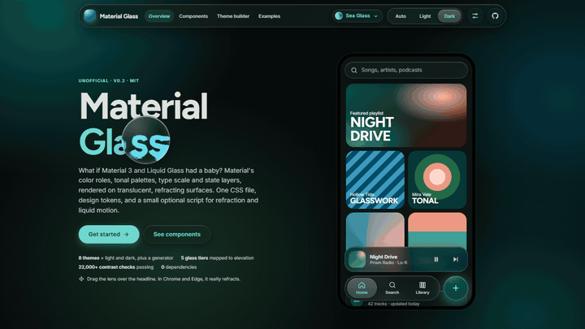
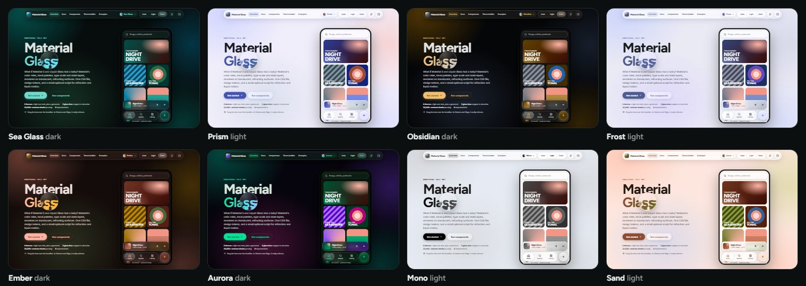
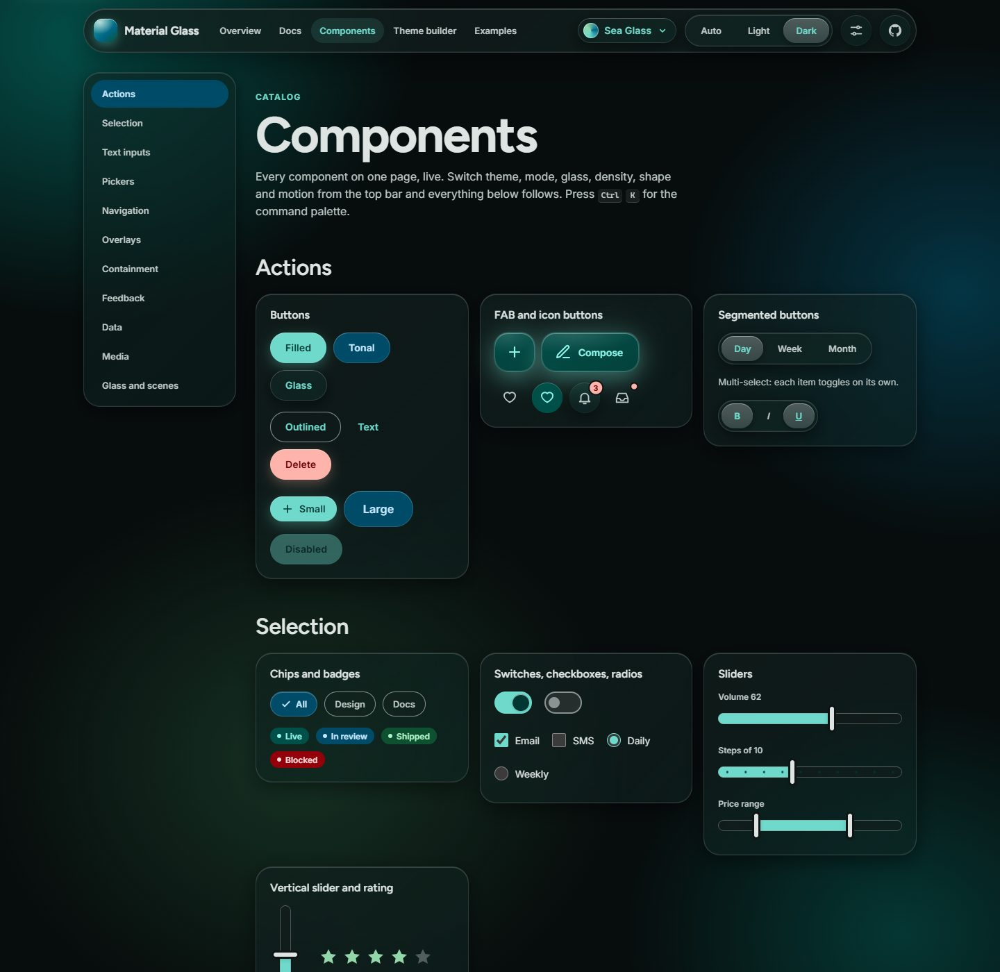
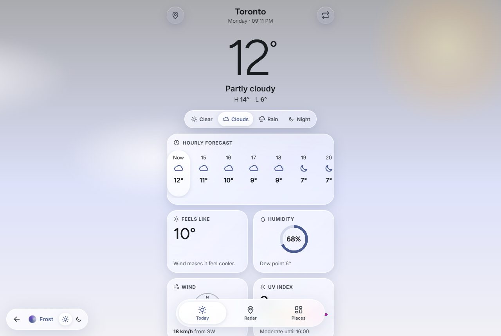
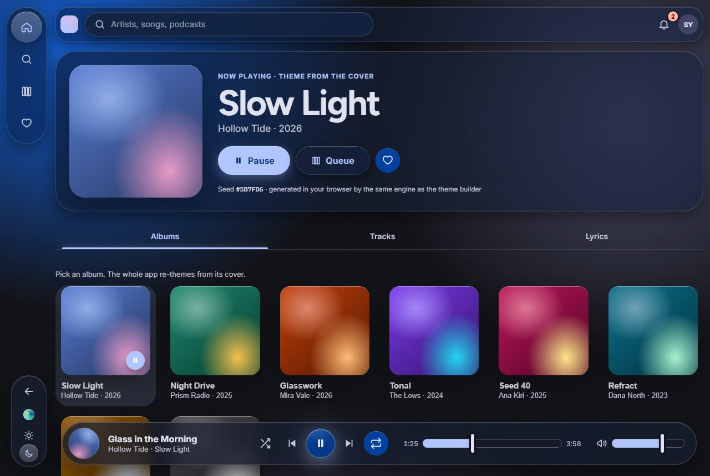
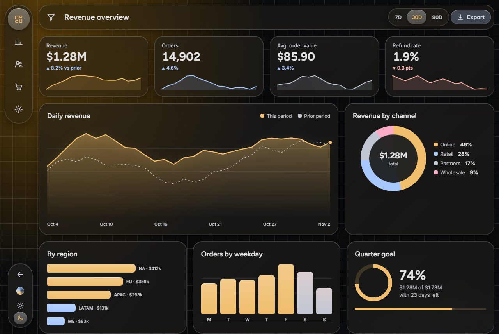
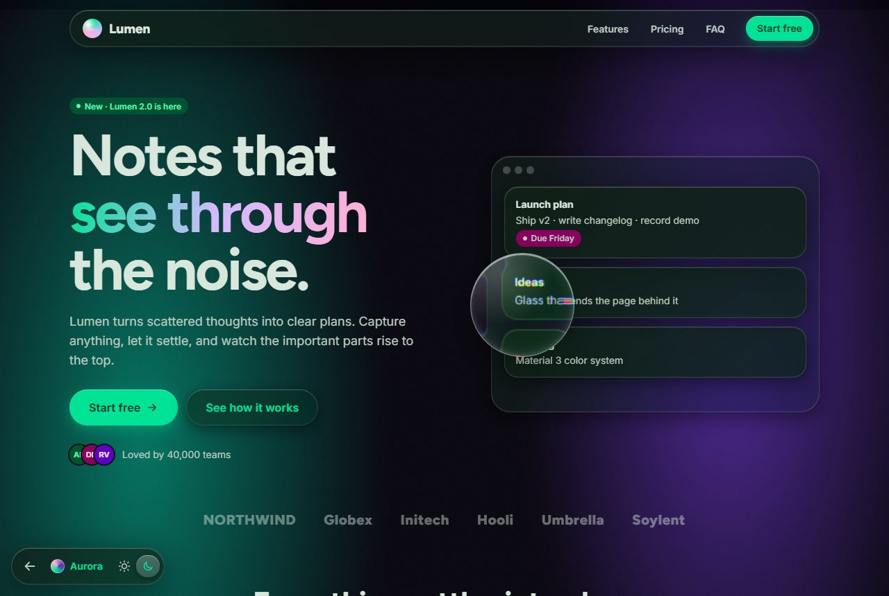

# Material Glass

**What if Material 3 and Liquid Glass had a baby?**

Material Glass takes Material 3's colour roles, tonal palettes, type scale and state layers, and renders them on translucent, refracting glass. It has eight themes and a theme generator, about 60 components, real edge refraction and liquid motion. Every glass surface is contrast-tested. The core has no dependencies and no build step.

**[Live demo](https://sky-five.github.io/material-glass/)** · **[Docs](https://sky-five.github.io/material-glass/guide/)** · **[Components](https://sky-five.github.io/material-glass/components.html)** · **[Theme builder](https://sky-five.github.io/material-glass/builder.html)** · **[Examples](https://sky-five.github.io/material-glass/examples/)**



> Unofficial community project. It is not affiliated with or endorsed by Google or Apple. "Material Design" and "Liquid Glass" belong to their owners.

## Quick start

```html
<link rel="stylesheet" href="https://cdn.jsdelivr.net/gh/sky-five/material-glass@0.2.0/material-glass.min.css">
<script defer src="https://cdn.jsdelivr.net/gh/sky-five/material-glass@0.2.0/material-glass.min.js"></script>

<html data-mg-theme="sea-glass" data-mg-mode="dark">
  <body class="mg-scene">
    <nav class="mg-nav mg-glass-3" data-mg-liquid data-mg-refract aria-label="Main">
      <a class="mg-nav__item" href="/" aria-current="page">Home</a>
      <a class="mg-nav__item" href="/library">Library</a>
    </nav>
    <div class="mg-card mg-glass-2">…</div>
    <button class="mg-btn">Save</button>
  </body>
</html>
```

The script is optional. Without it everything still looks right. With it you get liquid selection, refraction, anchored menus, pickers, sortable tables, toasts and more. It's about 12 KB gzipped.

## Why

Glassmorphism kits usually give you a blurred box and stop there. Material 3 gives you a rigorous colour and elevation system, but flat surfaces. Material Glass keeps Material's structure and swaps the material.

| Material 3 | Material Glass |
| --- | --- |
| Five surface-container levels | Five **glass tiers**. Higher tiers get more blur, opacity and edge light. |
| State layers of ink (8%, 12%, 16%) | The same percentages as **light** from the top edge. Pressed glass brightens and swells. |
| The selected pill appears in place | One **lit pane that flows** between items, stretching like a drop of liquid. |
| Flat containers | Real **refraction** at the rim in Chromium, with lens, ripple and chromatic profiles. |
| Accessible colour pairs | The same, plus **contrast measured through the glass**. Glass turns solid when it should. |

## Themes



| Theme | Character |
| --- | --- |
| `sea-glass` | Dark-first teal. The default. |
| `prism` | Light-first indigo with a coral accent |
| `obsidian` | Near-black and amber, for dashboards and dev tools |
| `frost` | Light-first cobalt and lilac, high blur |
| `ember` | Coral and gold on charcoal, for media and food |
| `aurora` | Mint, violet and magenta, gradient-forward |
| `mono` | Achromatic, the safe enterprise theme |
| `sand` | Paper tones, terracotta and olive, close to classic Material |

Each comes in light and dark. You can also make your own:

- **In the browser.** Use the [theme builder](https://sky-five.github.io/material-glass/builder.html). Pick a colour or drop in a photo, tune the glass, then copy the CSS. It runs live WCAG checks as you go.
- **From the command line.** `npm run themes -- --name lagoon --seed "#1E88E5"` or `--from-image photo.png`. It uses Google's Material Color Utilities.

## Customize

Every switch is a data attribute on `<html>` or any container:

```html
<html data-mg-theme="frost" data-mg-glass="milk" data-mg-density="compact" data-mg-shape="round" data-mg-motion="calm">
```

| Attribute | Options |
| --- | --- |
| `data-mg-glass` | `frosted`, `milk`, `smoked`, `crystal`, `clear`, `paper` |
| `data-mg-density` | `comfortable`, `compact`, `dense` |
| `data-mg-shape` | `sharp`, `soft`, `round`, `squircle` |
| `data-mg-motion` | `none`, `calm`, `standard`, `expressive` |
| `data-mg-font` | `system`, `inter`, `geist`, `jakarta`, `serif`, `mono` |
| `data-mg-type` | `fluid` |
| `data-mg-light` | `pointer`, `tilt`. Experimental: one light angle for every highlight. |

Components also expose variables such as `--mg-btn-radius`, `--mg-card-padding` and `--mg-tabs-indicator`. The CSS ships in cascade layers, so your own rules win without `!important`. See [Customization](https://sky-five.github.io/material-glass/guide/customization.html).

## Components



The components cover the Material 3 set:

- **Navigation:** top app bars, navigation bar, rail and drawer, tabs, bottom and side sheets, breadcrumbs, pagination.
- **Inputs:** buttons, FAB, chips, switches, checkboxes and radios, sliders (single, range, vertical, ticks), text fields (glass, outlined, filled, with validation and counters), select, menus, combobox, date and range picker, time picker, stepper, drop zone, colour input, rating, tag input.
- **Feedback:** linear (including wavy) and circular progress, skeletons, tooltips, toasts, banners, empty states, loading overlay.
- **Containment:** card variants, accordion, dividers, carousel, popover, dialog variants, command palette, split pane.
- **Data:** sortable and resizable tables, stat tiles, CSS bar charts, sparklines, legends, timeline, kanban, calendar, tree.
- **Media:** avatars and groups, badges, figure captions, video and audio players.

Browse them all in the [catalog](https://sky-five.github.io/material-glass/components.html). Press <kbd>Ctrl</kbd>+<kbd>K</kbd> there for the command palette.

## Examples

| | |
| --- | --- |
| [](https://sky-five.github.io/material-glass/examples/weather/) **Weather**: the sky changes with the forecast. | [](https://sky-five.github.io/material-glass/examples/music/) **Music**: the app re-themes from album art. |
| [](https://sky-five.github.io/material-glass/examples/dashboard/) **Analytics dashboard** on Obsidian | [](https://sky-five.github.io/material-glass/examples/landing/) **Landing page** template on Aurora |

## Frameworks, design tools, platforms

| Package | For |
| --- | --- |
| [`@material-glass/react`](packages/react) | Typed components and hooks, server-render safe |
| [`@material-glass/vue`](packages/vue) | Vue 3 with `v-model` and a plugin |
| [`@material-glass/svelte`](packages/svelte) | Svelte 5 with runes and bindable props |
| [`@material-glass/elements`](packages/elements) | Web Components, light DOM, no dependencies |
| [`@material-glass/tailwind`](packages/tailwind) | Tailwind v3 preset and v4 theme |

Tokens are exported for **Figma** and **Penpot** (W3C Design Tokens), **Tokens Studio**, and as **Swift**, **Kotlin/Compose** and **Dart/Flutter** colour files. See [Design tools](https://sky-five.github.io/material-glass/guide/design-tools.html).

## Install

```bash
npm i material-glass
```

```js
import 'material-glass/css';   // or 'material-glass/min.css', 'material-glass/unlayered.css'
import 'material-glass/js';
```

You can also load only what you use: `material-glass/core.css` plus `material-glass/components/inputs.css` and the other component files.

## Accessibility and testing

- **Contrast through the glass.** Over 22,000 WCAG checks run on every commit. They cover every theme, mode and glass tier composited over the theme's backgrounds, every text-safe glass preset, and a sweep of 72 generated themes.
- **Glass steps aside.** Reduced transparency, high contrast, forced colours, no `backdrop-filter`, and print all get solid Material surfaces.
- **Real controls.** Components use native buttons, inputs, dialogs, popovers and details, plus ARIA patterns with full keyboard support.
- **Tested in a browser.** CI runs axe-core on every page in both modes, 36 interaction checks, 43 visual baselines (themes, presets, density, shape, right-to-left), and 100 checks across the framework packages.
- **Right-to-left.** Logical properties are used throughout, and indicators mirror correctly.

## Browser support

Everything works in current Chrome, Edge, Safari and Firefox. Edge refraction uses SVG filters inside `backdrop-filter`, which only Chromium renders today. Other browsers keep the frosted blur. Newer features, including customizable `<select>`, `corner-shape`, scroll-driven animations and View Transitions, are progressive enhancements.

## Contributing

Issues and pull requests are welcome. See [CONTRIBUTING.md](CONTRIBUTING.md) for how the tokens, build and tests fit together. [SHOWCASE.md](SHOWCASE.md) lists sites built with Material Glass, so add yours.

## License

[MIT](LICENSE)
