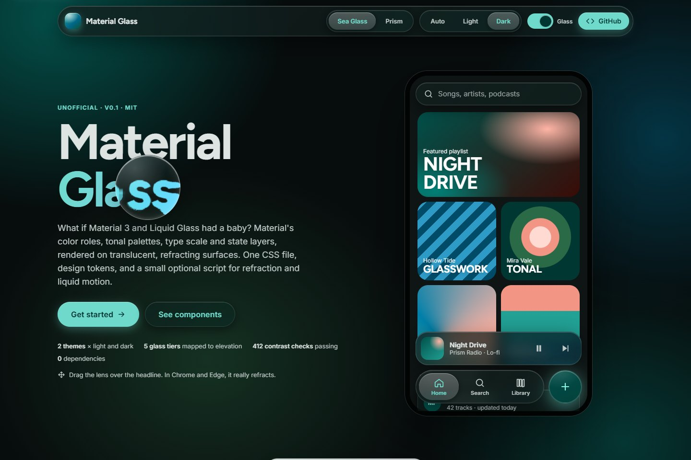
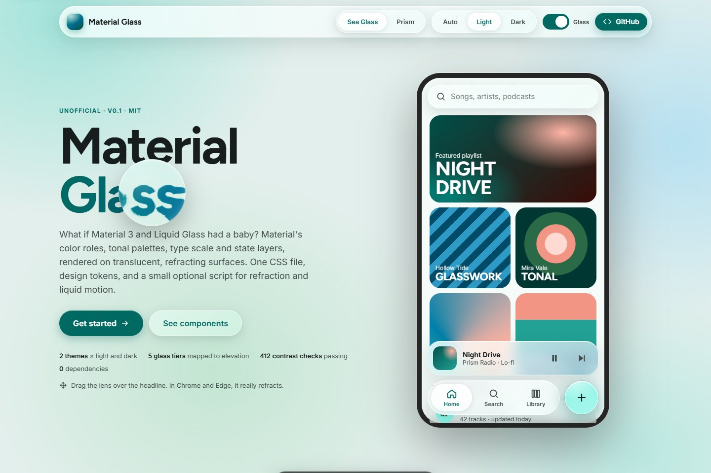
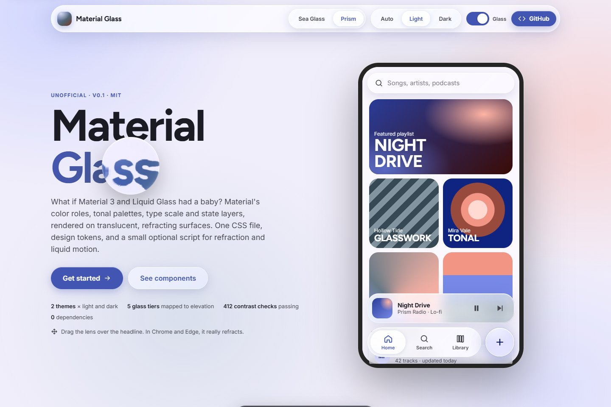
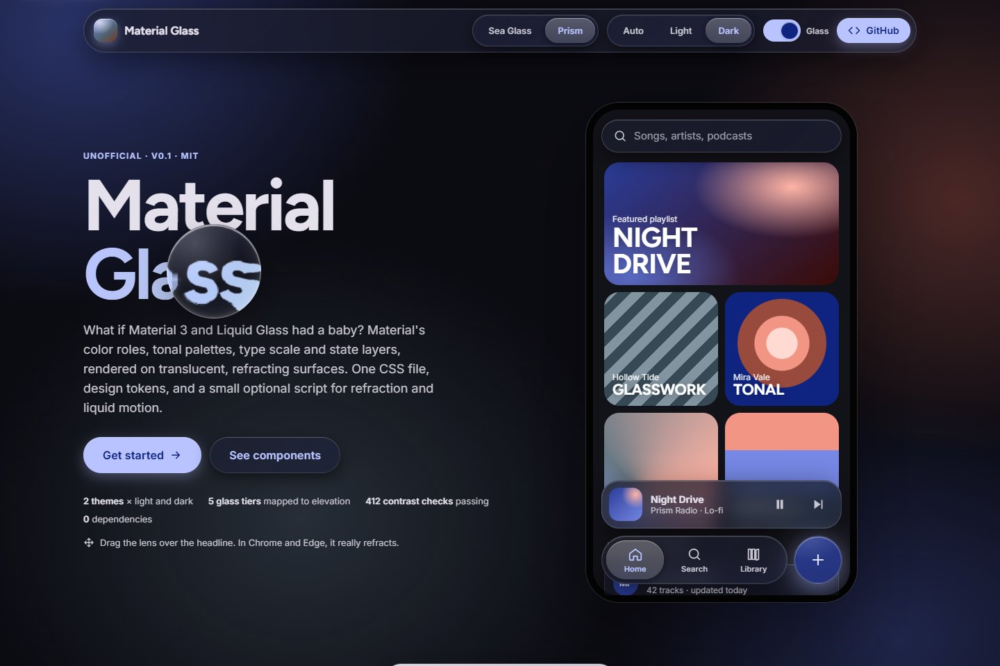
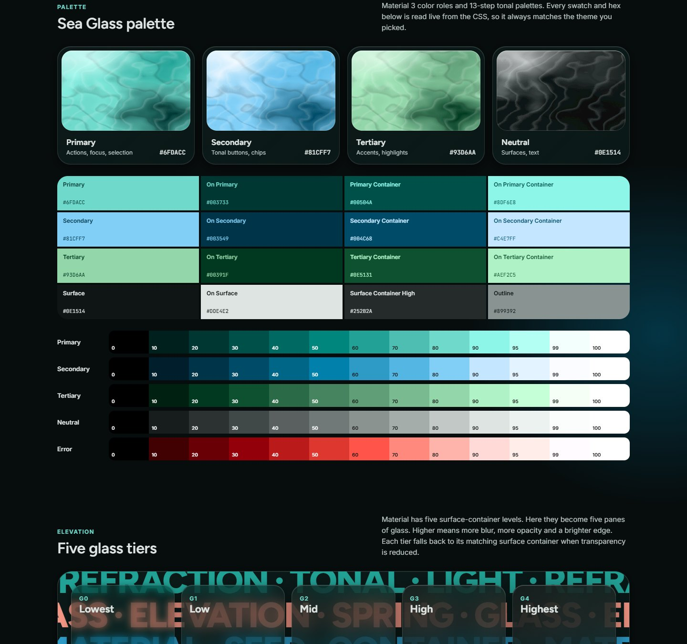
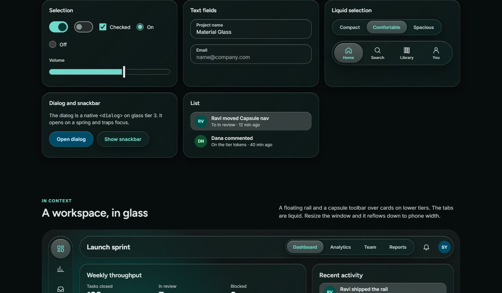
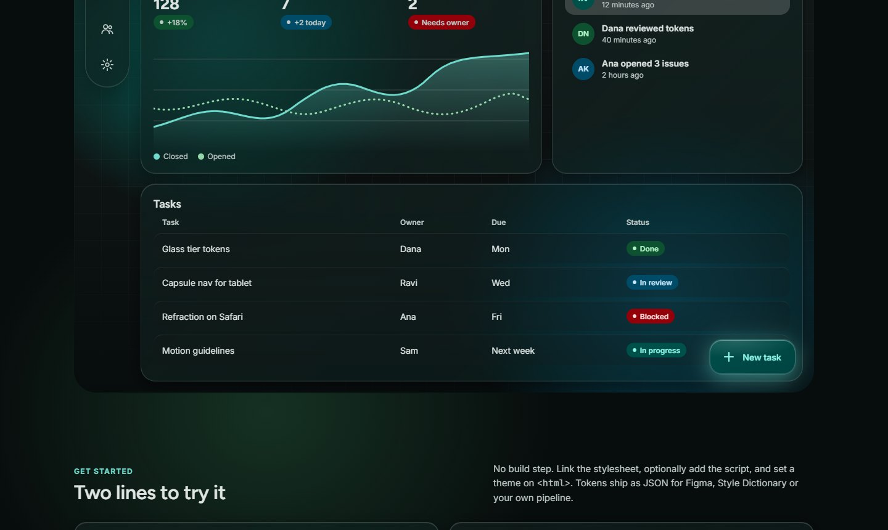

# Material Glass

**What if Material 3 and Liquid Glass had a baby?**

Material Glass takes Material 3's color roles, tonal palettes, type scale and state layers, and renders them on translucent, refracting glass surfaces. You get one CSS file, design tokens in JSON, and a small optional script for real edge refraction and liquid motion. There are no dependencies and no build step.

**[Live demo →](https://sky-five.github.io/material-glass/)**



> Unofficial community project. Not affiliated with or endorsed by Google or Apple. "Material Design" and "Liquid Glass" belong to their owners.

## Why

Glassmorphism kits usually give you a blurred box and stop there. Material 3 gives you a rigorous color and elevation system but flat surfaces. Material Glass keeps Material's structure and swaps the material:

| Material 3 | Material Glass |
|---|---|
| Five surface-container levels | Five **glass tiers**. More blur, opacity and edge light as elevation rises. |
| State layers of ink (8%, 12%, 16%) | The same percentages as **light** falling from the top edge. Pressed glass brightens and swells. |
| Selected pill appears in place | One **lit pane that flows** between items, stretching mid-flight like a drop of liquid. |
| Flat container colors | Real **refraction** at the rim, in Chromium browsers. |
| Accessible color pairs | Same, plus glass that **turns solid** for reduced transparency, high contrast and forced colors. |

## Quick start

```html
<link rel="stylesheet" href="https://cdn.jsdelivr.net/gh/sky-five/material-glass@0.1.0/material-glass.css">
<script defer src="https://cdn.jsdelivr.net/gh/sky-five/material-glass@0.1.0/material-glass.js"></script>

<html data-mg-theme="sea-glass" data-mg-mode="dark">
  <body class="mg-scene">
    <nav class="mg-nav mg-glass-3" data-mg-liquid data-mg-refract>
      <a class="mg-nav__item" href="/" aria-current="page">Home</a>
      <a class="mg-nav__item" href="/library">Library</a>
    </nav>
    <div class="mg-card mg-glass-2">…</div>
    <button class="mg-btn">Save</button>
  </body>
</html>
```

The script is optional. Without it everything still works, and you lose refraction, the flowing selection pill and the draggable lens.

## Themes

Two themes ship, each with light and dark modes.

| | Sea Glass (default) | Prism |
|---|---|---|
| Seed | `#26A69A` teal | `#4355B2` indigo |
| Character | Dark-first, frosted teal, glacial blue, viridian | Light-first, indigo with a coral accent |
| Light |  |  |
| Dark |  |  |

Set the theme with `data-mg-theme` and the mode with `data-mg-mode`. Leave out `data-mg-mode` to follow the system. Both attributes also work on any element to theme just that subtree.

```js
MaterialGlass.setTheme('prism', 'light'); // theme, then 'light' | 'dark' | 'auto'
```



## Glass tiers

| Class | Blur | Light alpha | Dark alpha | Solid fallback |
|---|---|---|---|---|
| `.mg-glass-0` | 8px | 0.36 | 0.34 | surface-container-lowest |
| `.mg-glass-1` | 14px | 0.48 | 0.46 | surface-container-low |
| `.mg-glass-2` / `.mg-glass` | 20px | 0.60 | 0.58 | surface-container |
| `.mg-glass-3` | 28px | 0.72 | 0.68 | surface-container-high |
| `.mg-glass-4` | 36px | 0.84 | 0.78 | surface-container-highest |

Glass needs something behind it to look like glass. Put `.mg-scene` on a page or section for an ambient backdrop with soft color fields and grain, or place glass over your own imagery.

## Components



| Component | Markup |
|---|---|
| Buttons | `.mg-btn` plus `--tonal`, `--glass`, `--outlined`, `--text`, `--danger`, `--sm`, `--lg` |
| Icon button | `.mg-icon-btn`. Toggle with `aria-pressed`. |
| FAB | `.mg-fab`, `.mg-fab--extended`. Tinted glass with a glow. |
| Chip | `.mg-chip` with `aria-pressed`. Optional `.mg-chip__check` icon. |
| Switch | `<button class="mg-switch" role="switch" aria-checked>` |
| Checkbox, radio | `.mg-check`, `.mg-radio` inside `.mg-choice` |
| Slider | `<input type="range" class="mg-slider">` |
| Text field | `<label class="mg-field"><span class="mg-field__label">…</span><input class="mg-field__input"></label>` |
| Search | `.mg-search` on a glass tier |
| Segmented | `.mg-segmented` > `.mg-segmented__item` with `aria-pressed` or `aria-selected` |
| Nav bar, rail | `.mg-nav` / `.mg-nav.mg-rail` > `.mg-nav__item` with `aria-current="page"` |
| Card | `.mg-card` on a glass tier |
| Dialog | `<dialog class="mg-dialog mg-glass-3">` |
| Snackbar | `.mg-snackbar` |
| List | `.mg-list` > `.mg-list-item`, `--interactive` |
| Badge, avatar | `.mg-badge` (`--primary`, `--tertiary`, `--error`), `.mg-avatar` |
| Table | `.mg-table` inside `.mg-table-wrap` |
| Lens | `.mg-lens` with `data-mg-draggable` |
| Type | `.mg-display`, `.mg-headline`, `.mg-title`, `.mg-body`, `.mg-label` |



## Enhancements in material-glass.js

| Attribute | What it does |
|---|---|
| `data-mg-refract="28"` | Bends the backdrop at the element's rim like a real lens. The value is strength in px. Add `data-mg-bezel` for the edge width and `data-mg-magnify="0.1"` to zoom the face. |
| `data-mg-liquid` | On a nav, rail or segmented control, the selection pill flows between items. It updates `aria-*` on click. Use `data-mg-liquid="manual"` to manage selection yourself. |
| `data-mg-draggable` | Pointer-drag inside the offset parent, with a spring swell. |

Refraction uses an SVG displacement map as a `backdrop-filter`. Only Chromium browsers render that today. Safari and Firefox keep the normal frosted blur, so nothing breaks.

## Tokens

[`tokens/material-glass.tokens.json`](tokens/material-glass.tokens.json) is the source of truth. It holds the tonal palettes, the color roles for each theme and mode, glass parameters, shape, state, motion and type. Every value is also a CSS custom property, for example `--mg-primary`, `--mg-primary-rgb`, `--mg-ref-primary-40`, `--mg-glass-blur-2` and `--mg-shape-lg`.

To add a theme, add an entry under `themes` and rebuild:

```bash
npm run build
```

```bash
npm test
```

## Accessibility

- **Contrast is tested.** `npm test` runs 412 WCAG checks across every theme and mode. They cover each on-color pair, text on every surface container, outlines, and text on glass tiers over the theme's own surfaces. CI fails if any drop below AA.
- **Glass steps aside.** `prefers-reduced-transparency`, `prefers-contrast: more`, `forced-colors`, browsers without `backdrop-filter`, and `data-mg-transparency="reduced"` on any ancestor all turn glass into the matching solid surface container.
- **Motion respects the user.** `prefers-reduced-motion` removes the spring, the swell and the liquid stretch.
- **Real controls.** Components are native buttons, inputs, links and dialogs with visible focus rings.

Glass over arbitrary photos can't be guaranteed to pass contrast. Use a higher tier, or reduced transparency, when text sits over busy imagery.

## Browser support

The styles work in current Chrome, Edge, Safari and Firefox. The spring easing uses `linear()` where supported and falls back to Material's emphasized curve elsewhere.

## Contributing

Issues and pull requests are welcome. New themes, components, and refraction for more browsers are especially useful. Edit `tokens/` or `src/`, then run `npm run build` and `npm test`. Don't edit `material-glass.css` by hand, because it's generated. `test/refraction.html` is a visual check for the displacement maps.

## License

[MIT](LICENSE)
